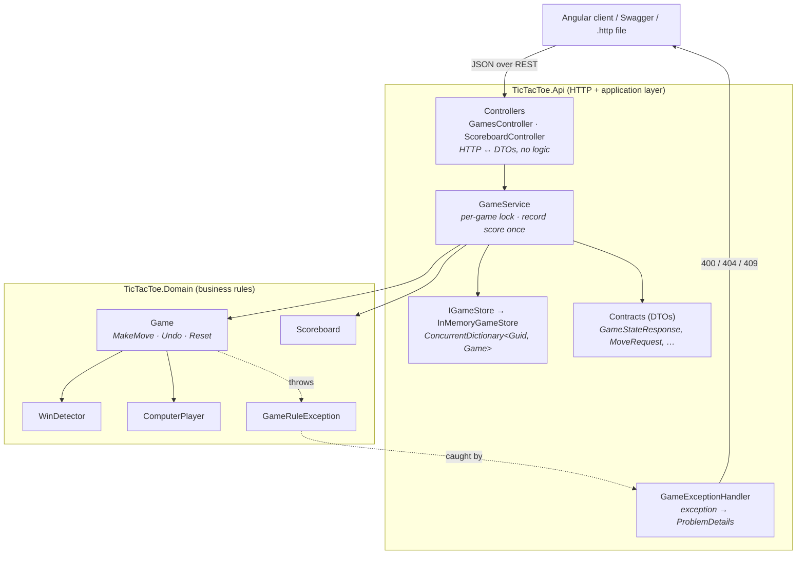
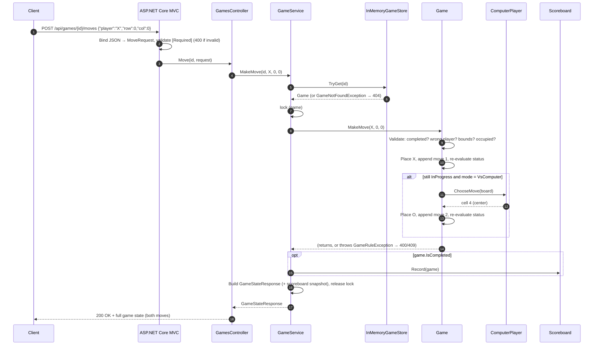

# Backend: TicTacToe .NET API

The ASP.NET Core Web API (.NET 10) behind the Tic Tac Toe app. It owns all game state: board, turns, move history, result, and scoreboard. The Angular client only renders what this API returns.

For the full project (frontend, Docker setup, design decisions and assumptions), see the [root README](../README.md).

## Architecture

### Layers

The backend uses a small **layered architecture**:
- The **domain layer** holds the game rules as plain C# with no web dependencies.
- The **application layer** coordinates requests and owns the in-memory state.
- The **HTTP layer** translates between HTTP and those two layers.

Each layer only calls the one below it.



| Layer | Knows about | Does not know about |
|---|---|---|
| **Domain** (`TicTacToe.Domain`) | Board, turns, wins, undo, computer moves, scoring | HTTP, JSON, DI, storage, threads |
| **Application** (`Services/`) | Finding games, locking, *when* to record the score, mapping results to DTOs | HTTP status codes, routing |
| **HTTP** (`Controllers/`, `Contracts/`, `Errors/`, `Program.cs`) | Routes, request validation, JSON, status codes, OpenAPI | Game rules |

**Why the layers are split this way:**
- **Rules are tested in isolation.** The 39 domain tests create a `Game` directly, with no web host.
- **Each concern has one home.** For example, "the computer can't move after the game ends" lives only in `Game.MakeMove`.
- **Storage can be swapped.** `IGameStore` is the only place that knows state lives in memory. Moving to SQLite would replace one class and leave the rules and controllers untouched.

### Request lifecycle: a move in computer mode



What to notice in this flow:
- **One request returns both moves.** The client never has to ask the server to make the computer's move, so the computer can never play out of turn.
- **The score is recorded exactly once.** `Game.MakeMove` throws if the game was already finished, so if the game is finished after a successful move, this request caused that change. With Option A, Undo can't reopen a finished game, and Reset starts a fresh one, so the change can't happen twice.
- **Validation happens in two places, each with a different job:**
  - MVC checks the request's *shape*: required fields and valid enum values.
  - The domain checks the *rules*: turn, bounds, occupied cell, game over.

### State and concurrency

| State | Lives in | Lifetime | Protection |
|---|---|---|---|
| All games | `InMemoryGameStore` (`ConcurrentDictionary<Guid, Game>`) | Singleton (API process) | Safe for many threads adding and looking up games at once |
| One game's board/moves | `Game` instance | Until the process stops | `lock (game)` in `GameService`: one request at a time per game; different games never block each other |
| Scoreboard | `Scoreboard` | Singleton | Internal `Lock` around every read and write |

All services are registered as **singletons** because the state must outlive individual HTTP requests:
- `IGameStore`
- `Scoreboard`
- `GameService`

`GameService` itself has no fields of its own beyond those two dependencies, so sharing one instance is safe.

The `lock (game)` covers a real scenario: a double-click, or two browser tabs on the same game. Without it, two moves could both pass validation before either one was recorded.

### Error flow

```
Game / GameService ── throw GameRuleException(code) / GameNotFoundException
        │
        ▼
UseExceptionHandler() ──▶ GameExceptionHandler (IExceptionHandler)
        │                      ├─ GameNotFoundException        → 404
        │                      ├─ GameRuleException OutOfBounds → 400
        │                      └─ other GameRuleException       → 409
        ▼
IProblemDetailsService ──▶ application/problem+json { status, title, detail, code }
```

- **Controllers contain no try/catch.** Mapping exceptions to HTTP lives in exactly one place.
- **Unexpected exceptions** are not handled by `GameExceptionHandler`. They fall through to the default handler, which returns 500 ProblemDetails without stack details.
- **Model-validation failures** (a missing `mode`, or an unknown enum value like `"Z"`) come back as 400 `ValidationProblemDetails`. `[ApiController]` produces these automatically.

### Composition root (`Program.cs`)

```csharp
builder.Services.AddControllers().AddJsonOptions(/* enums as strings */);
builder.Services.AddProblemDetails();
builder.Services.AddExceptionHandler<GameExceptionHandler>();
builder.Services.AddSingleton<IGameStore, InMemoryGameStore>();
builder.Services.AddSingleton<Scoreboard>();
builder.Services.AddSingleton<GameService>();
```

The middleware runs in this order:
1. Exception handler
2. Status-code pages
3. OpenAPI + Swagger UI
4. CORS (only used by `ng serve` outside Docker)
5. Controllers
6. `/health`

## Projects

```
backend/
├── TicTacToe.slnx                 solution (.NET 10 XML format)
├── Dockerfile                     build → test → publish → final (aspnet:10.0, non-root)
├── src/
│   ├── TicTacToe.Domain/          game rules (plain C#, no ASP.NET dependency)
│   └── TicTacToe.Api/             HTTP layer
└── tests/
    └── TicTacToe.Tests/           xUnit (domain, service, HTTP integration)
```

Dependencies point one way only: **Api → Domain** and **Tests → Api + Domain**. The domain never references the web layer, so all game rules can be unit-tested without HTTP.

### TicTacToe.Domain

| Type | Responsibility |
|---|---|
| `Game` | One game session. `MakeMove`, `Undo`, `Reset`. The move list is the single source of truth: the board, current player, and status are all derived from it. |
| `WinDetector` | The 8 winning lines. Returns the winner and winning cells, or whether the board is full. |
| `ComputerPlayer` | Deterministic O player: **win → block → center → corner → any free cell**. |
| `Scoreboard` | Thread-safe X wins / O wins / draws (`System.Threading.Lock`). |
| `GameRuleException` | Thrown for a rule violation, with a `GameRuleError` code: `OutOfBounds`, `CellOccupied`, `WrongPlayer`, `GameAlreadyCompleted`, `NothingToUndo`. |
| `Player`, `GameMode`, `GameStatus`, `Move` | Enums and the move-history record. |

How the main rules work:
- **Turn:** X always starts, so an even move count means it is X's turn and an odd count means O's. Undo therefore restores the correct turn automatically.
- **Validation order** in `MakeMove`:
  1. Game already completed
  2. Wrong player
  3. Out of bounds
  4. Cell occupied
- **Computer mode:** after a valid human move, the computer replies inside the same `MakeMove` call, but only if the game is still in progress.
- **Undo:**
  - In two-player mode, it removes one move.
  - In computer mode, it keeps removing moves until it is X's turn again (normally the computer's reply plus the human move before it).
  - Undo is not allowed once the game is completed (Option A).

### TicTacToe.Api

| Folder / file | Responsibility |
|---|---|
| `Controllers/GamesController` | `POST /api/games`, `GET /{id}`, `POST /{id}/moves`, `/undo`, `/reset` |
| `Controllers/ScoreboardController` | `GET /api/scoreboard`, `POST /api/scoreboard/reset` |
| `Services/GameService` | Locks each game while handling a request and records the score exactly once (when a move changes the game from `InProgress` to `Won` or `Draw`) |
| `Services/GameStore` | `IGameStore` plus `InMemoryGameStore` (`ConcurrentDictionary`). This is where SQLite could replace in-memory storage. |
| `Contracts/` | Request and response DTOs (`CreateGameRequest`, `MoveRequest`, `GameStateResponse`, …), kept separate from domain types |
| `Errors/GameExceptionHandler` | Maps exceptions to RFC 7807 ProblemDetails: **404** unknown game, **400** `OutOfBounds`, **409** other rule violations. The body includes a `code` field. |
| `Program.cs` | Controllers, string enums in JSON, OpenAPI + Swagger UI, ProblemDetails, `/health`, singleton services, and CORS for `ng serve` outside Docker |
| `TicTacToe.Api.http` | Runnable request examples for every endpoint, including invalid ones |

## Run

**With Docker** (run from the repo root):

```bash
docker compose up --build api
```

**Without Docker** (requires the .NET 10 SDK):

```bash
cd backend
dotnet run --project src/TicTacToe.Api
```

Either way, the API is served at:

| URL | What |
|---|---|
| http://localhost:5000/swagger | Swagger UI |
| http://localhost:5000/openapi/v1.json | OpenAPI document |
| http://localhost:5000/health | Health check |

## API at a glance

| Method | Endpoint | Body | Success | Errors |
|---|---|---|---|---|
| POST | `/api/games` | `{ "mode": "TwoPlayer" \| "VsComputer" }` | 201 | 400 |
| GET | `/api/games/{id}` | – | 200 | 404 |
| POST | `/api/games/{id}/moves` | `{ "player": "X", "row": 0, "col": 2 }` (0-based) | 200 | 400 · 404 · 409 |
| POST | `/api/games/{id}/undo` | – | 200 | 404 · 409 |
| POST | `/api/games/{id}/reset` | – | 200 | 404 |
| GET | `/api/scoreboard` | – | 200 | – |
| POST | `/api/scoreboard/reset` | – | 200 | – |

Every `/api/games` endpoint returns the full game state, with the scoreboard included. The response shape and error format are documented in the [root README, section 6](../README.md#6-api-endpoint-summary).

## Test

**With Docker** (run from the repo root):

```bash
docker compose --profile test run --rm --build api-tests
```

**Without Docker:**

```bash
cd backend
dotnet test
```

There are 56 tests:

| File | Focus |
|---|---|
| `GameTests` | Valid and invalid moves, turn switching, row, column and diagonal wins, draw, reset, undo in both modes, moves after completion |
| `ComputerPlayerTests` | One test per priority rule, with boards written as text (`"XX." + ".O." + "..."`) |
| `ScoreboardTests` | Counting, rejecting a game that isn't finished, reset |
| `GameServiceTests` | Score is recorded exactly once, reset keeps the score, O win is recorded, unknown game |
| `ApiTests` | Real HTTP via `WebApplicationFactory<Program>`: status codes, string enums, ProblemDetails `code` |

## Configuration notes

- **Port:** the container listens on 8080 (the .NET image default); compose maps it to host port 5000. The `http` launch profile also uses 5000.
- **HTTPS:** no HTTPS redirection, because TLS would be handled in front of the API (nginx or another reverse proxy).
- **API docs:** OpenAPI and Swagger UI are enabled in every environment, because documenting the API is part of the assignment.
- **State:** state is in memory and lost on restart. See [Known limitations](../README.md#11-known-limitations).
